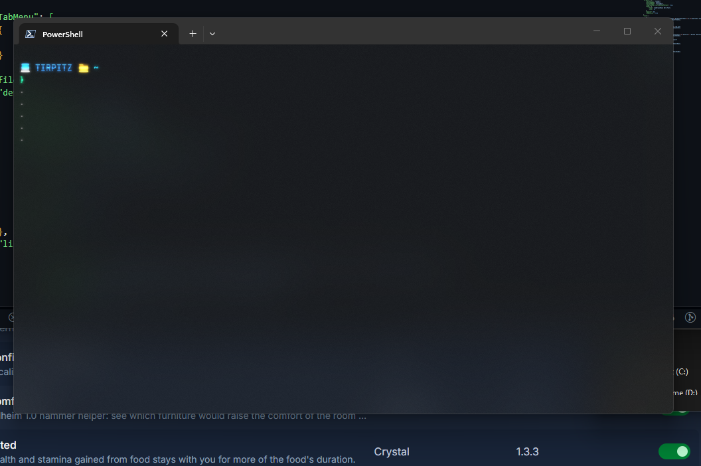

# Windows 11 shell setup

My PowerShell, Starship, and Windows Terminal configuration for Windows 11 devices. This repository contains configuration, not installers or application data.



Example from one device; the hostname in the prompt changes with the machine.

## Installed tools

- PowerShell 7 in Windows Terminal
- Starship prompt
- PSReadLine, Carapace, and PSFzf with fzf
- zoxide, Atuin, and eza
- JetBrainsMono Nerd Font (selected in Windows Terminal; install the font separately when restoring)

## Winget installs

These are the install commands recorded in this device's PowerShell history for the shell setup:

```powershell
winget install --id Microsoft.PowerShell --source winget --installer-type wix
winget install --id Starship.Starship
winget install --id ajeetdsouza.zoxide -e
winget install --id junegunn.fzf -e
winget install -e Atuinsh.Atuin
winget install --id rsteube.Carapace -e
winget install --id DEVCOM.JetBrainsMonoNerdFont -e
winget install -e --id eza-community.eza
```

PSFzf was installed separately with `Install-Module PSFzf -Scope CurrentUser`. No Windows Terminal Winget install command was found in the available history.

## Keybindings

- PSReadLine: `Ctrl+Down`/`Ctrl+Up` cycle suggestions; `Ctrl+Right` accepts the next word; `Tab` opens completion and `Shift+Tab` goes backward.
- PSFzf: `Alt+R` searches history and `Ctrl+T` selects provider items.
- Atuin: `Alt+T` opens interactive history search. Its `Ctrl+R` binding is disabled in the profile.
- Shift+Enter creates multiline input in the working setup. The current `settings.json` has no explicit Shift+Enter action; test it after restoration.

## Aliases and replacements

- `cd` uses zoxide smart navigation.
- `ls` and `ll` are eza functions; `ll` shows a detailed view.
- Starship supplies the prompt, including the Aspire indicator configured in `starship.toml`.
- The PowerShell Terminal profile launches `"C:\Program Files\PowerShell\7\pwsh.exe" -NoLogo -NoProfileLoadTime`.

## File locations

| Backup file | Restore to |
| --- | --- |
| `Microsoft.PowerShell_profile.ps1` | `$PROFILE` (normally `~/Documents/PowerShell/Microsoft.PowerShell_profile.ps1`) |
| `starship.toml` | `~/.config/starship.toml` |
| `settings.json` | `~/AppData/Local/Packages/Microsoft.WindowsTerminal_8wekyb3d8bbwe/LocalState/settings.json` |

## Restore

1. Install PowerShell 7, Windows Terminal, Starship, PSReadLine, Carapace, PSFzf, fzf, zoxide, Atuin, eza, and JetBrainsMono Nerd Font. Make command-line tools available on `PATH`.
2. In PowerShell, back up any existing destination files, then copy the three files above to their listed locations. Create the `Documents/PowerShell` and `.config` directories if needed.
3. Open a new Windows Terminal PowerShell tab. Confirm the prompt, `cd`, `ls`, `ll`, and keybindings, including Shift+Enter.

Atuin history, zoxide's learned directory database, installed applications, and the font files are not included.
